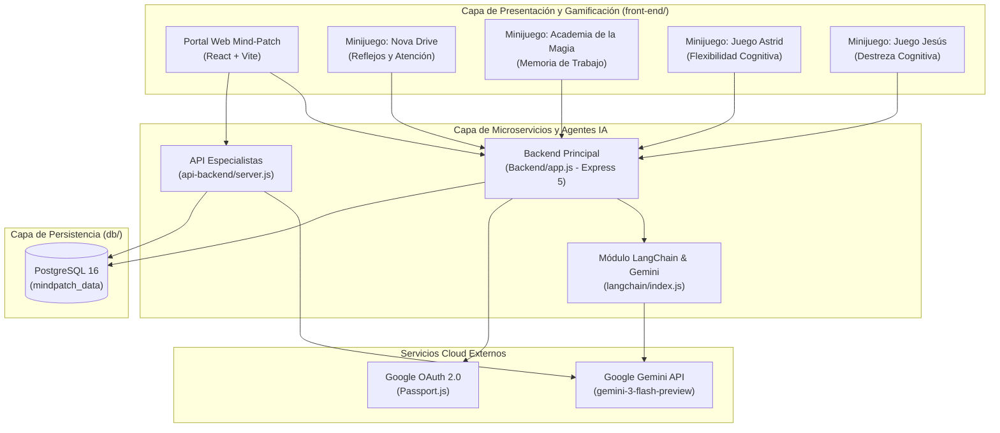

# Documentación Técnica: Mind-Patch

**Autor:** Roberto Alejandro Chagra Martínez  
**Tecnologías:** Node.js, Express 5, PostgreSQL 16, Sequelize, React, Vite, LangChain, Google Gemini AI (`@google/genai`), Passport OAuth2, JWT, Docker Compose  
**Tipo:** Plataforma Full-Stack Gamificada de Evaluación Cognitiva e Inteligencia Artificial  

---

## 1. Arquitectura del Sistema (Modelo C4)

El diseño arquitectónico de **Mind-Patch** sigue el estándar **C4 (Context, Containers, Components, Code)**, cuyos diagramas fuente y renderizados se encuentran organizados en [`diagrams/`](file:///g:/Mi%20unidad/Drive.alumno.udg.mx/Proyectos/Mind-Patch/C4), [`diagrams/`](file:///g:/Mi%20unidad/Drive.alumno.udg.mx/Proyectos/Mind-Patch/diagrams) y [`docs/`](file:///g:/Mi%20unidad/Drive.alumno.udg.mx/Proyectos/Mind-Patch/docs).

---

## 2. Componentes Backend y Microservicios

### 2.1. Backend Principal ([`Backend/`](file:///g:/Mi%20unidad/Drive.alumno.udg.mx/Proyectos/Mind-Patch/Backend))
Construido con Express 5 ([`Backend/app.js`](file:///g:/Mi%20unidad/Drive.alumno.udg.mx/Proyectos/Mind-Patch/Backend/app.js) y [`Backend/server.js`](file:///g:/Mi%20unidad/Drive.alumno.udg.mx/Proyectos/Mind-Patch/Backend/server.js)), gestiona la lógica central de negocio:
- **Autenticación Híbrida (`/api/auth`)**: Soporte para registro/login con hash `bcrypt`, emisión de tokens `jsonwebtoken` (JWT) y federación de identidad con Google OAuth 2.0 ([`Backend/modules/Auth/googleAuth.js`](file:///g:/Mi%20unidad/Drive.alumno.udg.mx/Proyectos/Mind-Patch/Backend/modules/Auth/googleAuth.js)).
- **Módulo de IA (`/api/ia`)**: Enrutamiento en [`Backend/routes/IA.routes.js`](file:///g:/Mi%20unidad/Drive.alumno.udg.mx/Proyectos/Mind-Patch/Backend/routes/IA.routes.js) que conecta las métricas de sesión y consultas del usuario con el motor generativo `@google/genai`.
- **Geolocalización y Mapas (`/api/maps`)**: Endpoints en [`Backend/routes/Maps.routes.js`](file:///g:/Mi%20unidad/Drive.alumno.udg.mx/Proyectos/Mind-Patch/Backend/routes/Maps.routes.js) para localizar especialistas y centros de atención cercanos.
- **Resultados de Minijuegos (`/api/res`)**: Endpoints en [`Backend/routes/Resultados.routes.js`](file:///g:/Mi%20unidad/Drive.alumno.udg.mx/Proyectos/Mind-Patch/Backend/routes/Resultados.routes.js) para almacenar puntajes, tiempos de reacción y telemetría cognitiva.

### 2.2. API de Especialistas ([`api-backend/`](file:///g:/Mi%20unidad/Drive.alumno.udg.mx/Proyectos/Mind-Patch/api-backend))
Microservicio enfocado en el directorio clínico, gestión de especialistas y creación programática de esquemas mediante [`api-backend/crearTablas.js`](file:///g:/Mi%20unidad/Drive.alumno.udg.mx/Proyectos/Mind-Patch/api-backend/crearTablas.js) y [`api-backend/server.js`](file:///g:/Mi%20unidad/Drive.alumno.udg.mx/Proyectos/Mind-Patch/api-backend/server.js).

### 2.3. Motor Conversacional con LangChain ([`langchain/`](file:///g:/Mi%20unidad/Drive.alumno.udg.mx/Proyectos/Mind-Patch/langchain))
Implementa flujos de procesamiento de lenguaje natural y cadenas de prompts utilizando `@langchain/google-genai`, `@langchain/openai` y el SDK `@google/genai` ([`langchain/index.js`](file:///g:/Mi%20unidad/Drive.alumno.udg.mx/Proyectos/Mind-Patch/langchain/index.js) y [`langchain/documentosn.js`](file:///g:/Mi%20unidad/Drive.alumno.udg.mx/Proyectos/Mind-Patch/langchain/documentosn.js)).

---

## 3. Esquema de Datos y Persistencia ([`database/`](file:///g:/Mi%20unidad/Drive.alumno.udg.mx/Proyectos/Mind-Patch/db))

La capa de datos utiliza **PostgreSQL 16** orquestado vía [`docker-compose.yml`](file:///g:/Mi%20unidad/Drive.alumno.udg.mx/Proyectos/Mind-Patch/docker-compose.yml):
- **Inicialización Automática**: Los scripts SQL dentro de [`db/init-01/`](file:///g:/Mi%20unidad/Drive.alumno.udg.mx/Proyectos/Mind-Patch/db/init-01) crean las tablas relacionales para usuarios, perfiles clínicos, sesiones de juego, métricas por partida e interacciones con el asistente de IA.
- **Persistencia en Volumen**: El volumen Docker `mindpatch_data` garantiza la durabilidad de los datos transaccionales y cuenta con *healthchecks* (`pg_isready`) antes de levantar el contenedor `backend`.

---

## 4. Ecosistema Frontend y Minijuegos ([`front-end/`](file:///g:/Mi%20unidad/Drive.alumno.udg.mx/Proyectos/Mind-Patch/front-end))

Cada minijuego está desacoplado modularmente para evaluar dominios cognitivos específicos:
- [`front-end/front end - Mind Patch-Diseño web/`](file:///g:/Mi%20unidad/Drive.alumno.udg.mx/Proyectos/Mind-Patch/front-end/front%20end%20-%20Mind%20Patch-Dise%C3%B1o%20web): Aplicación SPA principal contenerizada con Nginx en producción (puerto `5173:80`).
- [`front-end/nova-drive/`](file:///g:/Mi%20unidad/Drive.alumno.udg.mx/Proyectos/Mind-Patch/front-end/nova-drive): Simulación de navegación espacial para medir atención selectiva y reflejos.
- [`front-end/Juego_Academia_de_la_magia/`](file:///g:/Mi%20unidad/Drive.alumno.udg.mx/Proyectos/Mind-Patch/front-end/Juego_Academia_de_la_magia): Evaluación gamificada de memoria secuencial.
- [`front-end/juego-astrid/`](file:///g:/Mi%20unidad/Drive.alumno.udg.mx/Proyectos/Mind-Patch/front-end/juego-astrid): Aplicación React para pruebas de agilidad mental.
- [`front-end/Juego_Jesus_1_Archivo/`](file:///g:/Mi%20unidad/Drive.alumno.udg.mx/Proyectos/Mind-Patch/front-end/Juego_Jesus_1_Archivo): Módulo ligero en HTML5/JS para pruebas rápidas de concentración.

---

## 5. Artefactos de Diseño y Documentación

- **Diagramas Arquitectónicos ([`diagrams/`](file:///g:/Mi%20unidad/Drive.alumno.udg.mx/Proyectos/Mind-Patch/diagrams))**: Contiene los diagramas C4 Nivel 1 (Contexto), Nivel 2 (Contenedores/Componentes) y Nivel 3, así como diagramas UML, Tech Stack, Flujo de Usuario e Integración End-to-End en formatos `.drawio`, `.svg`, `.png` y `.jpeg`.
- **Especificaciones y Reportes ([`docs/`](file:///g:/Mi%20unidad/Drive.alumno.udg.mx/Proyectos/Mind-Patch/docs))**: Documentos de planteamiento del problema, requisitos técnicos, estructura de flujo de usuario y propuestas de minijuegos.
